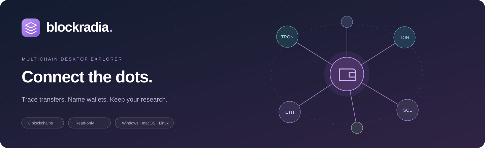

<div align="center">



# BlockRadia

**A desktop blockchain explorer and wallet investigation workspace**

Explore nine networks, trace transfers in an interactive graph, and save your research locally.

[**Download BlockRadia**](#download) · [First investigation](#your-first-investigation) · [Networks](#supported-networks) · [Build from source](#build-from-source)

</div>

## Download

The **latest release** is available for Windows, macOS, and Linux. Choose the package for your operating system and processor. If GitHub asks you to sign in, use an account with access to the repository.

| Platform | Architecture | Download |
| :--- | :--- | :--- |
| **Windows** | Intel / AMD 64-bit | [**Portable EXE**](https://github.com/gumonoid/blockradia/releases/latest/download/BlockRadia-Windows-x64.exe) |
| **macOS** | Apple Silicon — M1 / M2 / M3 / M4 and later | [**DMG**](https://github.com/gumonoid/blockradia/releases/latest/download/BlockRadia-macOS-arm64.dmg) · [ZIP](https://github.com/gumonoid/blockradia/releases/latest/download/BlockRadia-macOS-arm64.zip) |
| **macOS** | Intel 64-bit | [**DMG**](https://github.com/gumonoid/blockradia/releases/latest/download/BlockRadia-macOS-x64.dmg) · [ZIP](https://github.com/gumonoid/blockradia/releases/latest/download/BlockRadia-macOS-x64.zip) |
| **Linux** | Intel / AMD 64-bit | [**AppImage**](https://github.com/gumonoid/blockradia/releases/latest/download/BlockRadia-Linux-x86_64.AppImage) · [tar.gz](https://github.com/gumonoid/blockradia/releases/latest/download/BlockRadia-Linux-x64.tar.gz) |

[All releases](https://github.com/gumonoid/blockradia/releases) · [SHA-256 checksums](https://github.com/gumonoid/blockradia/releases/latest/download/SHA256SUMS.txt) · [Build pipeline](https://github.com/gumonoid/blockradia/actions/workflows/desktop-release.yml)

### Start exploring

1. **Windows** — open the portable EXE.
2. **macOS** — open the DMG and drag BlockRadia into Applications, or extract the ZIP. Choose Apple Silicon or Intel to match your Mac.
3. **Linux** — mark the AppImage executable and run it, or extract the tar.gz package.

Packaged downloads include the desktop runtime. An internet connection supplies blockchain and market data. The interface defaults to English and also supports Russian and Simplified Chinese. The Windows package requires Windows 10 or later. Linux requires Chromium sandbox support, including unprivileged user namespaces for the AppImage launcher. Windows and macOS may show warnings on first launch. See the release notes for the signature status and use SHA256SUMS.txt to check download integrity.

## Features

| Find activity | Follow transfers | Save your work |
| :--- | :--- | :--- |
| Search addresses, hashes and exchange labels | Expand and pin wallets on the relationship graph | Keep several wallets and investigations open in tabs |
| Load up to 100 operations for a date range | Open transaction details alongside the table | Save graph positions, labels and investigation notes |
| Filter by asset, amount, direction and status | Compare native balances and market charts | Watch up to ten wallets and review notifications |
| Customize columns and use your local time zone | Switch between price lines and Kraken candles | Export transaction tables as CSV and graphs as JSON |

Exchange labels include their source and coverage notes. [Exchange address registry](docs/EXCHANGE_LABELS.md)

## Supported networks

Base and Polygon wallet history uses Alchemy through the shared server. End users do not need provider keys. Their overview combines recent RPC blocks with growthepie analytics: network-wide daily transactions, daily active addresses, and a 30-day activity chart. Daily statistics show their UTC date and source; they are not all-time transaction or address totals. The current incomplete UTC day is excluded. [growthepie definitions and coverage](https://docs.growthepie.com/).

| Network | Native asset | Date history | Token and graph coverage | Pending feed | Recent history limit |
| :--- | :---: | :--- | :--- | :---: | :--- |
| Bitcoin | BTC | Esplora block and address archive | UTXO outputs; graph attribution requires a single input address | Yes | 100 displayed rows |
| Ethereum | ETH | Blockscout or bounded RPC archive | Native, ERC-20 and internal transfers with the indexer | — | Up to 100 rows per indexed stream |
| TRON | TRX | TronGrid account archive or TRON block archive | Native and TRC-20 transfers | — | 100 native and 100 token operations |
| Solana | SOL | Solana RPC archive, subject to node retention | Parsed system and supported SPL transfer instructions | — | Up to 100 signatures in extended analysis |
| GRAM(TON) | GRAM(TON) | TON Center archive | Native internal messages and indexed Jetton wallet transfers with known precision | — | 100 native transactions and 100 Jetton transfers |
| Base | ETH | Alchemy, Blockscout or bounded RPC archive | Native, internal and ERC-20 transfers with an indexer | — | Up to 100 incoming and 100 outgoing via Alchemy |
| Arbitrum | ETH | Blockscout or bounded RPC archive | Indexed transfers; restricted ERC-20 log fallback | — | Up to 100 rows per indexed stream |
| Polygon | POL | Alchemy, Blockscout or bounded RPC archive | Native, internal and ERC-20 transfers with an indexer | — | Up to 100 incoming and 100 outgoing via Alchemy |
| Optimism | ETH | Blockscout or bounded RPC archive | Indexed transfers; restricted ERC-20 log fallback | — | Up to 100 rows per indexed stream |

Date search returns up to 100 rows per selected range. Provider availability and retention can reduce coverage. The transaction table displays up to 100 rows, even when the graph loads additional token or internal transfers.

Kraken supplies USD candles for every price period. DefiLlama provides a line-chart fallback. The app uses the shared API for most requests and public providers directly for TRON and Solana date-range history. Activity charts identify whether they show indexed network statistics, RPC performance intervals, or only the downloaded transaction sample.

### What the graph means

A line represents transfers returned by the selected provider, grouped by direction and asset. Selecting it shows the underlying transactions. A nickname is your own annotation; it does not establish the real-world identity of a wallet owner.

This is a lightweight explorer using public APIs, **not a complete blockchain indexer or an AML attribution database**. Limits and partial failures are shown in the interface:

- EVM indexer responses use the latest available pages. RPC fallback covers a bounded block range and may be restricted by the provider.
- TRON loads up to 100 recent native operations and 100 token operations. Unknown token precision is not guessed.
- GRAM(TON) combines native messages and indexed Jetton transfers. If token precision is missing, the transfer is skipped and the sample is marked partial.
- Solana decodes up to 100 recent signatures progressively in extended wallet analysis. Unsupported or unavailable details remain explicitly incomplete.

**No visible connection does not prove that no transfer exists.**

## Your first investigation

1. Select the correct network and paste a public wallet address or transaction hash. Use **Ctrl + K** to focus search.
2. Review the native balance as soon as it arrives; history and graph data follow separately.
3. Select a node, add a nickname, then choose **Expand wallet relationships** in the inspector.
4. Select a connection to inspect its amounts and transaction hashes. Drag the graph or use zoom / fit controls to adjust the view.
5. Open **History** to rename or revisit wallets. Export rows as CSV, or save the graph and notes under **Saved investigations**. Export an investigation as JSON and import it from the same panel on another computer.
6. To watch a wallet, open **Notifications** and choose **Watch this wallet**. On supported desktops, enable system tray monitoring to keep checking after closing the window. Quitting BlockRadia stops checks.

<details>
<summary>Market charts, fee estimates and transaction coverage</summary>

Network fees refresh independently on load, once per minute when automatic updates are enabled, on returning to the tab, and with the refresh button. Each quote shows its source and observation time. EVM networks report the mean observed gas price in the latest block (Gwei), with a labelled RPC estimate for empty blocks; additional L1 fees on rollups are excluded. Bitcoin shows a three-block confirmation fee estimate in sat/vB, TRON shows live Energy and Bandwidth burn tariffs in SUN, and Solana/GRAM(TON) show mean observed transaction fees in their native currency. Failed refreshes retain the previous quote with an unavailable notice and its original timestamp.

Fee definitions: [Ethereum execution API](https://ethereum.github.io/execution-apis/next/api/methods/eth_getBlockByNumber/), [Bitcoin fee estimates](https://github.com/Blockstream/esplora/blob/master/API.md#fee-estimates), [TRON resource prices](https://developers.tron.network/docs/bandwidth-and-energy), [Solana fees](https://solana.com/docs/core/fees), and [GRAM(TON) transaction fields](https://docs.ton.org/api/v3/blockchain-data/get-transactions).

The transaction table displays up to 100 recent unique transactions, ten per page. Large transfers are selected from that same sample using the native-currency threshold for each network. Public provider failures or a shorter wallet history can result in fewer rows.

Price charts offer line and Japanese candlestick views for 1H, 4H, 24H, 7D, 14D, 30D, 90D, and 1Y. The 1H range uses 60 one-minute exchange candles; 4H uses 48 five-minute candles from [Kraken public OHLC](https://docs.kraken.com/api-reference/market-data/get-ohlc-data). The current unfinished candle is identified in its tooltip. All networks and periods use Kraken USD OHLC: 24H uses hourly candles, 7D and 14D use four-hour candles, and 30D, 90D and 1Y use daily candles. Exchange failures fall back to a labelled DefiLlama line chart; synthetic candles are not shown. Activity charts use line view only. The price card and chart display signed change over the selected period, green for growth and red for decline. Native wallet balances include an approximate USD valuation using the current available coin price; missing balances or quotes are never treated as zero. Large GRAM(TON) transfers must exceed 500 GRAM(TON); exactly 500 GRAM(TON) is excluded, and outgoing native messages are included.

</details>

## Build from source

### Shared server mode

New desktop builds use the shared API at `https://blockradia-api.onrender.com`, so desktop users do not need provider keys. The backend, Docker image, and Render deployment configuration are included. See [deployment and desktop configuration](docs/SHARED_SERVER.md). The free preview server can take about a minute to wake after inactivity. Server hosting does not change provider plan restrictions.

### Requirements

- Node.js **22.13 or newer** and npm.
- Git to clone the repository.
- Windows, macOS, or Linux. Native platform packages are built on their corresponding operating systems.

```bash
git clone https://github.com/gumonoid/blockradia.git
cd blockradia
npm ci
npm run desktop:install
npm start
```

`npm start` builds the interface and launches Electron. The first development launch may download the official Electron runtime.

### Indexer API access

Set `BLOCKSCOUT_API_KEY` in the environment before launching BlockRadia to use the official multichain Blockscout API. The key stays in the backend and is never included in API responses or the UI bundle. Access depends on your key's network permissions and plan; Base requires a paid tier according to [Blockscout's Base API documentation](https://docs.blockscout.com/base-api).

Without a key, public explorer endpoints are used. Some endpoints restrict automated access. If an indexer refuses access, the overview loads up to 48 recent blocks as needed to fill the 100-transaction sample through public RPC and labels the activity chart as a sample. Network-wide transaction and address totals remain unavailable rather than being estimated.

### Create desktop packages

Run the appropriate command **on the target operating system**:

```bash
npm run dist:win    # Windows x64 portable executable
npm run dist:mac    # macOS Intel and Apple Silicon DMG / ZIP
npm run dist:linux  # Linux x64 AppImage / tar.gz
```

Build output is written to `release/`. Dependencies, generated bundles, runtime state, credentials, and desktop binaries are excluded from Git.

### Checks

```bash
npm run check
npm test
npm run build
```

Tests cover address validation, token amount precision, GRAM(TON) address canonicalization, independent market-data failures, request deadlines, cancellation, shared in-flight requests, and slow Solana history responses.

## Source map

```text
app/
  page.tsx                     Main explorer and search state
  globals.css                  Responsive UI styles
  api/explorer/route.ts         Read-only API adapters and request budgets
components/explorer/
  WalletGraph.tsx              Interactive transfer graph and node expansion
  HistoryPanel.tsx             Research history and nickname editor
lib/explorer-client.ts         Client deadlines and cancellation
desktop/
  main.cjs                    Electron window and internal request routing
  build.mjs                   UI build and server adapter compilation
  ui/                         React desktop entry point
scripts/checksums.mjs          SHA-256 release manifest
tests/                        Adapter and timeout regression tests
.github/workflows/             Cross-platform build and release pipeline
```

## How releases are built

The **Build desktop packages** workflow validates the source, builds packages on Windows, macOS, and Linux runners, checks that every required asset exists, and publishes the release only after all three platform builds succeed. It also generates `SHA256SUMS.txt`. Official GitHub Actions are pinned to specific commits. The **Verify changes** workflow runs type checks, tests and a build on pull requests. It also starts the unpacked Windows application with fixture data and verifies wallet navigation and fullscreen controls. See [release signing](docs/RELEASE_SIGNING.md) for configuring signed future releases.

Maintainers can run it from **Actions → Build desktop packages → Run workflow**, or push a version tag after updating both package versions. A published version is not silently overwritten; a new release requires a version bump.

## Data and privacy

- **Read-only:** no private keys, wallet signatures, or fund transfers are used.
- **Local annotations:** history, bookmarks, and nicknames are stored in the application's local profile. Sharing exports is an explicit action.
- **Internet lookups:** searched public addresses are sent to the corresponding blockchain API providers. Market quotes use Kraken and DefiLlama.
- **Isolated desktop window:** Node.js access is disabled in the renderer, with sandbox and context isolation enabled.
- **Local service:** the embedded API binds only to `127.0.0.1:19237`. It is not a public web service.

---

<div align="center">

**BlockRadia — make blockchain relationships easier to explore.**

[Download](#download) · [Latest release](https://github.com/gumonoid/blockradia/releases/latest) · [Changelog](CHANGELOG.md)

</div>
